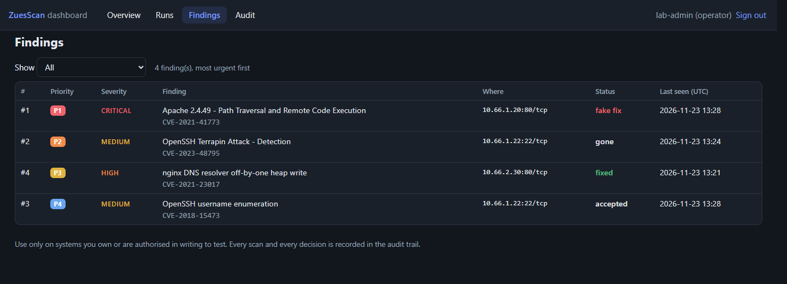
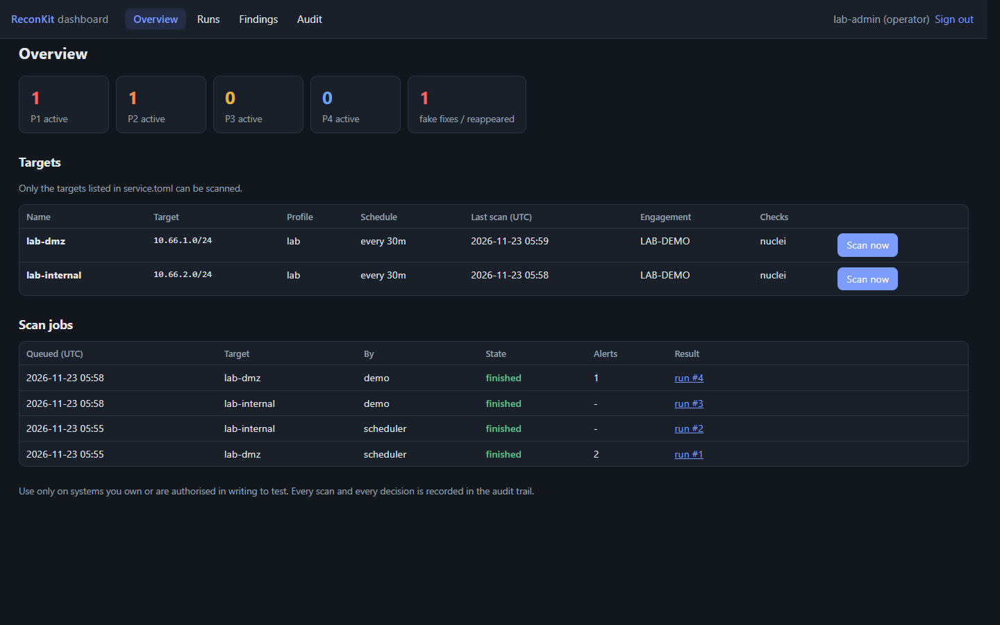
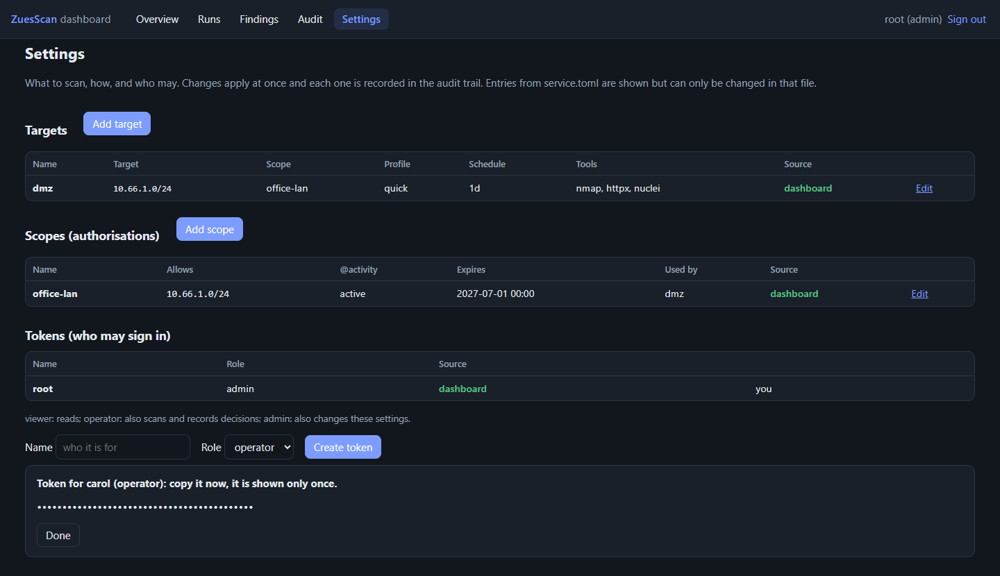
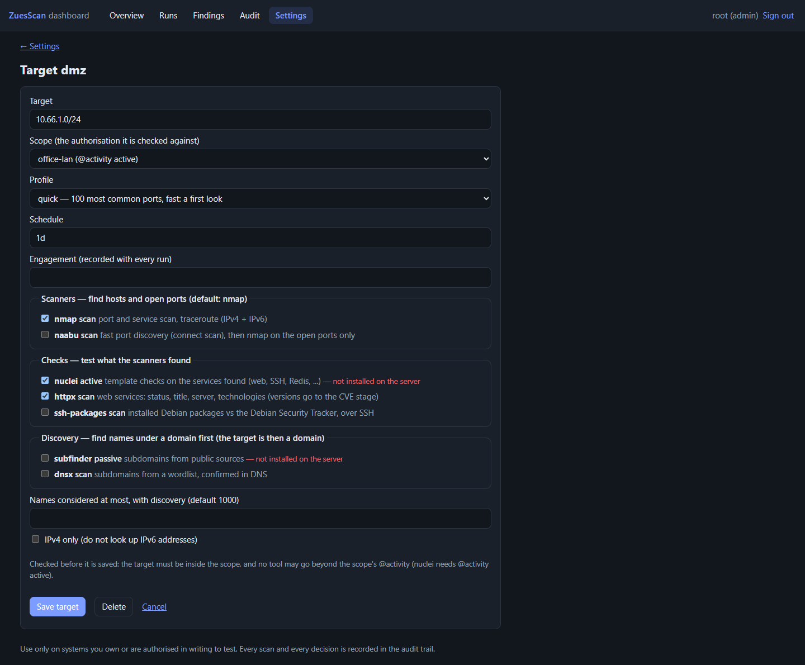
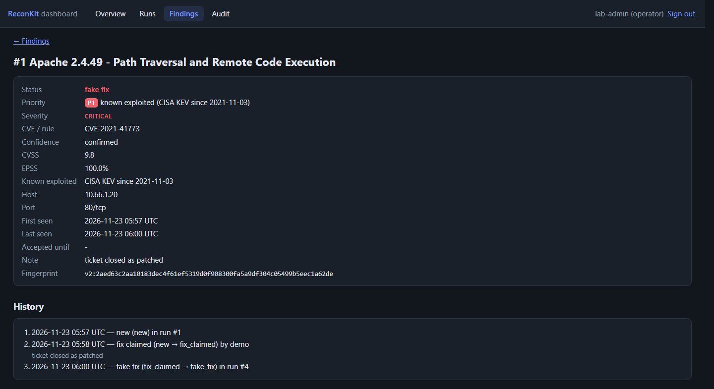
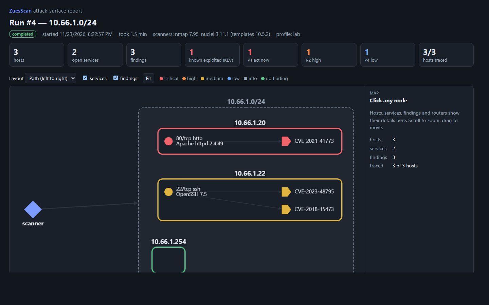

# ZuesScan

Bộ điều phối recon & quản lý lỗ hổng chạy nền (đồ án an toàn thông tin).

Lệnh: `zues`. Trước 0.2.0 dự án tên là *ReconKit* — dữ liệu tạo từ thời đó vẫn dùng được.

> ⚠️ Chỉ dùng trên tài sản của mình hoặc được uỷ quyền bằng văn bản (lab, mạng nội bộ, chương trình có scope hợp pháp).

## Tài liệu thiết kế (SDD v0.1)
https://claude.ai/artifact/69X8tKYCnShu8rYwzaNiV8

## ZuesScan làm gì

Quét định kỳ những gì **được phép** quét, nhớ mọi thứ đã thấy, và chỉ ra điều cần làm:

- **Cổng scope** trước mọi gói tin: allowlist / denylist, giấy phép có hạn (`@expires`), khung
  giờ (`@window`); tên miền phải phân giải ra địa chỉ trong scope.
- **Quét** bằng công cụ mở: nmap (dịch vụ, traceroute, IPv4 + IPv6), naabu, httpx, subfinder, dnsx, nuclei, kiểm tra
  gói qua SSH (Debian). **CVE** từ NVD, xếp **ưu tiên** KEV → EPSS → CVSS (P1–P4).
- **Vòng đời finding** qua các lần quét: mới / còn mở / báo đã sửa / **đã xác minh vá** /
  **fix giả** / tái xuất hiện / chấp nhận rủi ro có hạn.
- **Bằng chứng & trách nhiệm**: output gốc của scanner giữ lại có SHA-256; audit trail là chuỗi
  băm (ai quét gì, theo giấy phép nào, ai quyết định gì).
- **Báo cáo**: bản đồ bề mặt tấn công HTML (mở offline), JSON, SARIF 2.1.0.
- **Dịch vụ**: lịch quét, hàng đợi Redis + worker, web API + dashboard có phân quyền, cảnh báo
  webhook, Docker Compose làm cứng, backup có kiểm tra, và một **lab có lỗ hổng** để thử.

| Dashboard | Bản đồ: máy quét → router → dải mạng → host → dịch vụ → CVE |
|---|---|
|  |  |

Chạy thử toàn bộ trong 2 lệnh (cần Docker): `sh lab/up.sh` rồi `sh lab/demo.sh` — xem mục
[Lab](#lab-có-lỗ-hổng). Lộ trình: [`TASKS.md`](TASKS.md) · Thiết kế:
[`docs/THIET-KE.md`](docs/THIET-KE.md) · Giới hạn: [`docs/KNOWN-GAPS.md`](docs/KNOWN-GAPS.md).

## Cài đặt trên một máy mới

**Cách 1 — Docker, 3 lệnh** (có sẵn mọi thứ: nmap, nuclei, templates, subfinder, dnsx, naabu,
httpx, ssh; không phải sửa file nào):

```bash
git clone https://github.com/B23DCAT011/reconkit && cd reconkit
docker compose up -d --build                                # Redis, web, worker, scheduler
docker compose exec web zues user add tôi --role admin      # in token đăng nhập MỘT lần
```

Mở http://127.0.0.1:8000, dán token, vào **Settings**: thêm scope (được quét gì), thêm target
và chọn tool, rồi **Scan now** — hoặc đặt lịch. Đã thử đúng các bước này trên volume trống: từ
`up` tới run đầu tiên được lưu, không có `service.toml`.

Khi đã có bản phát hành, dùng image dựng sẵn thay vì build (chỉ cần `compose.yaml`):

```bash
export ZUES_IMAGE=ghcr.io/b23dcat011/zues-scan:0.2.0       # linux/amd64 + linux/arm64
cosign verify $ZUES_IMAGE \
  --certificate-identity-regexp 'https://github.com/B23DCAT011/reconkit/.github/workflows/release.yml@refs/tags/v.*' \
  --certificate-oidc-issuer https://token.actions.githubusercontent.com    # image do CI ký thật
docker compose pull web worker scheduler && docker compose up -d --no-build
```

**Cách 2 — Python** (Python 3.11+, Linux / macOS / Windows):

```bash
pipx install git+https://github.com/B23DCAT011/reconkit       # hoặc: pip install --user ...
zues doctor               # máy có gì, thiếu gì, và lệnh cài đúng cho hệ điều hành này
sudo apt install nmap         # (ví dụ) gói hệ thống: ZuesScan chỉ in lệnh, không tự cài
zues tools install        # nuclei, subfinder, dnsx, naabu, httpx, templates: không cần admin
zues doctor               # "ready to scan"
```

Chia việc như vậy là có chủ ý:

| Công cụ | Ai cài | Vì sao |
|---|---|---|
| nmap, ssh (và Npcap trên Windows) | **người dùng**, bằng trình quản lý gói của hệ thống (`zues doctor` in đúng lệnh) | cần quyền admin, cài driver / capability; một công cụ bảo mật không được tự leo quyền; Npcap bản miễn phí không được đóng gói phân phối kèm |
| nuclei, subfinder, dnsx, naabu, httpx, nuclei-templates | **ZuesScan** (`zues tools install`) | một file chạy được, giấy phép MIT; cài vào thư mục của người dùng, không cần admin |

`zues tools install` tải **đúng** bản đã ghim trong `zues_scan/data/tools.lock` cho nền tảng
này (Linux / macOS amd64 + arm64, Windows amd64), từ chối file có SHA-256 khác, chỉ lấy đúng file
chạy trong mỗi zip, giải nén templates an toàn, rồi ghi SHA-256 của những gì đã cài:

```bash
zues tools list           # bản ghim, bản đã cài, và chương trình ZuesScan sẽ dùng
zues tools verify         # có gì bị sửa từ lúc cài không
zues tools path           # thư mục chứa nuclei / subfinder / dnsx (thêm vào PATH nếu muốn gọi tay)
```

ZuesScan tìm công cụ theo thứ tự: bản nó đã cài → PATH → chỗ bộ cài nmap của Windows đặt (nên
nmap vừa cài xong vẫn dùng được dù terminal đang mở chưa thấy PATH mới). Templates đã cài được
dùng tự động, và mỗi run ghi `nuclei 3.11.1 (templates 10.5.2)`. Image Docker được dựng bằng
đúng file lock và đúng code này.

## Cài đặt (dev)

```bash
python -m venv .venv
.venv/Scripts/activate        # Windows; macOS/Linux: source .venv/bin/activate
pip install -e ".[dev]"
pytest
pip install -e ".[dev,server,server-test]"   # thêm test của dịch vụ chạy nền (Redis giả trong RAM)
```

## Plugin: thêm / bớt công cụ

```bash
zues plugins                                   # plugin nào có, loại gì, mức chủ động, sẵn sàng chưa
zues scan 10.0.0.0/24 --scope scope.txt --check nuclei --check exposed-git
pip install ./examples/zues-exposed-git        # thêm một plugin = cài một gói Python
```

nmap, naabu, httpx, nuclei, subfinder, dnsx, kiểm tra gói qua SSH là plugin dựng sẵn; công cụ khác thêm
bằng một gói Python khai báo entry point `zues_scan.plugins` — không sửa ZuesScan. Mỗi plugin khai **mức chủ
động** (`passive` / `scan` / `active`) và file scope quyết định được tới đâu (`@activity`).
Hướng dẫn viết plugin, bộ kiểm tra hợp đồng và ví dụ: [`docs/PLUGINS.md`](docs/PLUGINS.md).

**Scanner thứ hai: naabu** (`--scanner naabu`). Ba bước: nmap dò host sống (`-sn`), naabu quét
cổng của các host đó bằng *connect scan* (không cần raw socket, Npcap hay root) với tốc độ cố
định (`max_rate`, mặc định 1000/giây), rồi nmap nhận diện dịch vụ **chỉ trên các cổng mở** —
nên vẫn có tên + phiên bản dịch vụ cho bước CVE. Dò host phải nhờ nmap vì naabu không làm được
khi không có root; thiếu bước này, quét toàn cổng một dải /24 gần trống là 15,7 triệu kết nối
(hàng giờ). Đo thật trên lab (DMZ /24, 3 host sống), kết quả trùng khớp với nmap:

| profile | nmap | naabu (+ nmap `-sn` / `-sV`) |
|---|---|---|
| `quick` (top 100 cổng) | 8 s | 13 s |
| `lab` (65.535 cổng) | 13 s | 40 s với `--max-rate 20000` (≈200 s ở 1000/giây) |

Tức là trên mạng LAN nhanh, nmap (SYN scan tự điều tốc) vẫn nhanh hơn; naabu đáng dùng khi quét
nhiều host qua đường trễ cao (Internet) với tập cổng nhỏ, hoặc khi cần tốc độ cố định, dễ đoán.
naabu chỉ có `top 100`, `top 1000` và `full`: profile hỏi top N khác thì dùng danh sách gần nhất
lớn hơn (có ghi chú trong run).

## Kiểm tra máy: `zues doctor`

Trước khi quét trên một máy mới, `zues doctor` cho biết máy có gì, thiếu gì và **lệnh cài
đúng cho hệ điều hành đó** (apt / dnf / pacman / apk / zypper, brew, winget):

```text
$ zues doctor
ZuesScan 0.1.0 on Debian GNU/Linux 13 (trixie), Python 3.13.18

  ok       nmap              7.95 (/usr/bin/nmap)
  warn     nmap rights       no raw-socket rights: without them nmap falls back to a TCP
                             connect scan and cannot traceroute
                             -> sudo setcap cap_net_raw+eip /usr/bin/nmap  and  export NMAP_PRIVILEGED=1
  missing  nuclei            not found (optional)
  ...
ready to scan (2 thing(s) above would make scans better)
```

- **nmap là bắt buộc** (thiếu → mã thoát 1, "not ready"); nuclei, subfinder, ssh, dữ liệu CVE,
  gói dịch vụ là tuỳ chọn. Với nmap còn kiểm **quyền raw socket**: root, file capability
  `cap_net_raw` (đọc thẳng thuộc tính `security.capability` của file) + `NMAP_PRIVILEGED`, hay
  Npcap trên Windows — thiếu quyền thì nmap âm thầm chuyển sang TCP connect scan, chậm hơn và
  không traceroute được. Trên Windows còn nhận ra nmap đã cài nhưng chưa có trong PATH.
- **ZuesScan không tự cài gói hệ thống** (nmap, ssh): việc đó cần quyền admin, và một công cụ
  bảo mật không được tự leo quyền; Npcap bản miễn phí cũng không được đóng gói phân phối kèm.
- `--config service.toml` kiểm thêm cấu hình dịch vụ, database, Redis; `--json` cho script / CI.

Chính lệnh này đã tìm ra image Docker thiếu SSH client (quét có đăng nhập không chạy được trong
Docker) và việc `subfinder -version` tự ghi file cấu hình vào volume dữ liệu — cả hai đã sửa.

## Dùng thử

```bash
# scope.txt: allowlist, mỗi dòng một target (host / IP / CIDR, '!' = deny, '#' = chú thích)
printf 'scanme.lab\n10.0.0.0/24\n!10.0.0.1  # router, khong duoc quet\n' > scope.txt

zues scan scanme.lab --scope scope.txt --db zues.db
zues scan 10.0.0.0/24 --scope scope.txt        # quét cả dải, tự loại trừ 10.0.0.1
zues scan 10.0.0.0/24 --scope scope.txt --traceroute   # ghi cả đường đi tới từng host (profile full bật sẵn)
```

### Lớp web: httpx

```bash
zues scan 10.0.0.0/24 --scope scope.txt --check httpx            # service.toml: checks = ["httpx"]
```

nmap gọi tên web server ("Apache httpd 2.4.49"); thứ chạy **phía sau** nó — PHP, WordPress,
Grafana, jQuery — chỉ lộ ra trong câu trả lời HTTP. httpx lấy trang gốc của mọi dịch vụ web mà
lần quét tìm được (tên dịch vụ có "http"; cổng chưa có tên thì các cổng web thường gặp), thử
HTTPS rồi HTTP, **không theo redirect** (mức `scan`, như probe của nmap; tốc độ theo `check_rate`).
Kết quả gắn vào dịch vụ: URL, mã trạng thái, tiêu đề, header `Server`, công nghệ (bộ nhận diện
Wappalyzer) — hiện trong đầu ra `zues scan`, bản đồ HTML, API, MCP và được lưu trong database:

```
    80/tcp     http            nginx 1.20.0
                               web: 200 "Welcome to nginx!"  [Nginx:1.20.0]
```

Công nghệ **có phiên bản** mà ZuesScan biết tên CPE (Apache, nginx, IIS, Tomcat, Jetty, PHP,
WordPress, Drupal, Moodle, phpMyAdmin, Grafana, Jenkins, GitLab, jQuery, Bootstrap, OpenSSL…)
được đưa vào bước CVE như phần mềm chạy trên cổng đó — tìm được lỗ hổng của PHP 7.4 dù nmap chỉ
thấy nginx. Cùng một CVE do nmap và httpx cùng suy ra là **một** finding, bằng chứng ghi cả hai
("the web check (httpx) recognised 'Nginx:1.20.0' in the HTTP answer"). Chỉ dùng địa chỉ IP, không
dùng tên (httpx sẽ tự phân giải lại tên, có thể ra địa chỉ cổng scope chưa duyệt) — nên chưa phân
biệt virtual host (G29). Tiêu đề, tên công nghệ đến từ máy bị quét: bỏ ký tự điều khiển, giới hạn
độ dài, luôn hiển thị dạng text. Lab chạy httpx cùng nuclei trên cả hai target.

### Kiểm tra chủ động bằng nuclei

`--nuclei` chạy template nuclei trên các dịch vụ mà nmap tìm được. Đây là kiểm tra **chủ động**
(gửi request khai thác an toàn), chỉ dùng khi giấy phép cho phép. Lỗi nuclei thấy được là
`confirmed` — mạnh hơn suy đoán theo phiên bản.

```bash
zues scan 10.0.0.0/24 --scope scope.txt --nuclei
zues scan 10.0.0.0/24 --scope scope.txt --nuclei --nuclei-templates /opt/nuclei-templates
```

- **Web** (HTTP/HTTPS) được kiểm bằng URL theo **địa chỉ** đã duyệt; tên miền (vhost) gửi qua
  Host header + SNI. **Dịch vụ khác** (SSH, Redis, FTP…) được kiểm bằng `địa-chỉ:cổng` trong một
  lượt riêng chỉ với template mạng (`-pt javascript,tcp,ssl`) — vd OpenSSH dính *Terrapin*
  (CVE-2023-48795). Đo trên lab: cho cổng SSH chạy qua mọi template mất 147 s, chỉ template mạng
  thì tức thì, cùng kết quả.
- **An toàn**: không interactsh (mục tiêu không gọi ra máy chủ công cộng), bỏ template `dos`,
  `fuzz`, `intrusive`, `bruteforce`, không bật template `code` / `headless` / `file` / DAST,
  chỉ chạy template **có chữ ký hợp lệ** của ProjectDiscovery (`-dut`: template bị sửa hay bị
  cài thêm không chạy), bỏ mức `info` (nhận diện công nghệ, thiếu header — không phải lỗ hổng),
  giới hạn request/giây theo `--max-rate` của profile (mặc định 50).
- **Templates ghim**: `--nuclei-templates DIR` (hoặc biến `ZUES_NUCLEI_TEMPLATES`; image
  Docker đặt sẵn) chạy đúng bộ templates đó, offline, với thư mục cấu hình mới cho mỗi lần chạy;
  phiên bản templates được ghi cùng run (`nuclei 3.11.1 (templates 10.5.2)`). Không có thì
  nuclei dùng cài đặt riêng của máy.
- **Thời gian**: cả bước nuclei dùng chung giới hạn `timeout` của profile. Hết giờ thì giữ
  những gì đã thấy, run thành `partial` kèm ghi chú (thiếu finding không chứng minh là sạch).
  nuclei hỏng giữa chừng cũng không làm mất kết quả nmap — run `partial`.
- Một CVE vừa được nuclei thấy vừa khớp theo phiên bản là **một** finding: giữ bản quan sát
  (`confirmed`, bằng chứng của nuclei) nhưng lấy CVSS / KEV / EPSS từ cơ sở dữ liệu CVE, và
  nối thêm bằng chứng theo phiên bản.

### Quét có đăng nhập (Debian)

```toml
# creds.toml — chỉ SSH key, không nhận mật khẩu
[[ssh]]
hosts = ["10.0.0.0/24"]
user = "audit"                                 # tài khoản thường, không cần sudo
key = "~/.ssh/zues_audit"
known_hosts = "~/.ssh/zues_known_hosts"    # host key phải có sẵn ở đây
```

```bash
zues cve sync --debian bookworm      # tải Debian Security Tracker (~90 MB)
zues scan 10.0.0.0/24 --scope scope.txt --cve-cache zues-cve.db --credentials creds.toml
```

ZuesScan đọc gói đã cài và báo những CVE mà bản vá chưa được cài — chính xác hơn đoán theo
banner, vì Debian vá bằng backport mà không đổi số version của phần mềm. Ngược lại, CVE nào gói
đã có bản vá thì các finding đoán theo banner cho CVE đó bị rút lại.

### Scan profile

```bash
zues profiles                                   # liệt kê profile + tuỳ chọn nmap tương ứng
zues scan 10.0.0.0/24 --scope scope.txt --profile full           # cả 65.535 cổng + traceroute
zues scan 10.0.0.5 --scope scope.txt --profile quick --timing 3   # ghi đè một thông số
zues scan 10.0.0.5 --scope scope.txt --ports 22,80,8000-8100
zues scan 10.0.0.0/24 --scope scope.txt --config zues.toml --profile nightly
```

| Profile | Quét gì | Dùng khi |
|---|---|---|
| `quick` | 100 cổng phổ biến, `-T4`, timeout 5 phút | xem nhanh |
| `standard` (mặc định) | 1.000 cổng phổ biến, `-T4`, timeout 15 phút | quét thường |
| `full` | cả 65.535 cổng TCP + traceroute, timeout 4 giờ | quét định kỳ |
| `gentle` | 1.000 cổng, `-T2`, tối đa 50 gói/giây | mạng yếu / thiết bị dễ treo |

File cấu hình (TOML) thêm profile mới dựa trên một profile dựng sẵn:

```toml
[profiles.nightly]
base = "full"
timing = 3
max_rate = 300        # gói/giây của nmap
check_rate = 20       # request/giây của kiểm tra chủ động (nuclei); mặc định: max_rate, rồi 50
host_timeout = 1800   # bỏ một host sau 30 phút
```

`max_rate` (gói tin của nmap) và `check_rate` (request HTTP/mạng của nuclei) là hai thứ khác
nhau: gói SYN rất nhẹ, request khai thác thì nặng. Gộp làm một từng làm lần quét đủ 65.535 cổng
của lab chậm đi ~30 lần (nmap bị giới hạn theo mức hợp với nuclei).

Mỗi run lưu tên profile và toàn bộ thông số: hai run khác profile thì không nhìn cùng một tập
cổng, nên không so sánh được với nhau.

`--traceroute` ghi lại các router nằm giữa máy quét và từng host (dùng để vẽ bản đồ). Probe
chỉ gửi tới host trong scope; router trên đường đi chỉ trả lời "TTL hết hạn", không bị quét.
nmap cần quyền raw socket (root trên Linux, Npcap trên Windows); target nằm ngay trên máy
quét thì không có route.

Quy tắc của scope:

- **Tên miền trong allowlist chưa đủ.** ZuesScan phân giải tên một lần, và *mọi* IP nó trỏ
  tới cũng phải nằm trong allowlist; nếu không sẽ từ chối và nêu rõ IP nào. Vì vậy file
  scope phải khai cả IP / dải của máy, không chỉ tên. nmap luôn được đưa **IP** đã kiểm tra,
  không bao giờ là tên.
- **Wildcard.** `*.example.com` cho phép mọi *tên* dưới example.com (không gồm example.com).
  `zues scan example.com --discover` dùng subfinder tìm subdomain (thụ động, không gửi gì
  tới mục tiêu), rồi chỉ quét những tên có mọi địa chỉ nằm trong scope; tên bị loại được ghi
  lại kèm lý do (20 tên đầu, còn lại đếm gộp). Nguồn công khai có thể trả về **hàng chục nghìn**
  tên (thử thật với `example.com`: 25.514 tên, 87% từ một bộ dữ liệu rác), nên: chỉ xét tối đa
  `--discover-limit` tên (mặc định 1000, ưu tiên tên gần tên miền gốc), phân giải song song, và
  bỏ tên chỉ trỏ về đúng địa chỉ của bản ghi **wildcard DNS** (`*.example.com` trả lời mọi tên).
  API key cho các nguồn của subfinder nằm trong file provider config của subfinder:
  `--subfinder-config FILE` (hoặc `ZUES_SUBFINDER_CONFIG`, hoặc file sẵn có của bạn ở
  `~/.config/subfinder/`); không có key thì chỉ các nguồn miễn phí trả lời.
- **Tên không có trong nguồn công khai: dnsx.** `--discoverer dnsx` (dùng riêng hoặc cùng
  subfinder: `--discoverer subfinder --discoverer dnsx`) hỏi thẳng DNS `<từ>.<tên miền>` với
  từng từ của một wordlist và giữ tên phân giải được — tìm ra `vpn.`, `intranet.`, máy staging
  cũ… vốn không bao giờ có chứng chỉ công khai. Vì có gửi truy vấn tới DNS của mục tiêu nên
  mức của nó là `scan` (không phải thụ động), tốc độ bị chặn bởi `check_rate` của profile
  (mặc định 100 truy vấn/giây). Wordlist mặc định là danh sách riêng của ZuesScan (~370 tên
  phổ biến, quét xong trong vài giây); danh sách lớn hơn: `--dns-wordlist FILE` (service:
  `dns_wordlist`). Hai tên ngẫu nhiên được hỏi kèm để nhận ra **wildcard DNS**; tên chỉ trả về
  đúng địa chỉ của wildcard bị bỏ ngay. Resolver là resolver của hệ thống (`/etc/resolv.conf`
  — cùng resolver mà cổng scope dùng), nên tên nội bộ phân giải được trong mạng nội bộ.
  Đã thử thật với một máy chủ DNS riêng (CoreDNS): tìm đủ 6 tên (kể cả tên chỉ có AAAA), và
  với một vùng wildcard thì loại cả 374 tên "giả".
- **IPv6 cũng vậy.** Tên được phân giải ra cả IPv4 và IPv6; địa chỉ IPv6 cũng phải có trong
  scope (vd `2001:db8::/64`), hoặc quét `--ipv4-only`. Không quét quét dải IPv6 lớn hơn /112.
- **Deny thắng allow.** Quét một dải có chứa địa chỉ bị cấm thì địa chỉ đó được loại trừ
  (`nmap --exclude`); target bị cấm toàn bộ thì bị từ chối.
- **Kết quả được kiểm lại.** Máy nào scanner trả về mà nằm ngoài scope sẽ không được lưu và
  CLI in cảnh báo.

### Theo dõi qua nhiều lần quét

Mỗi lần quét được đối chiếu với **kho tài sản** (mọi host, cổng, lỗi đã từng thấy). Sau khi quét,
CLI in ra những gì thay đổi, và cảnh báo khi một lỗi đã báo sửa vẫn còn (**fix giả**) hoặc lỗi cũ
quay lại:

```bash
zues findings                     # lỗi còn mở, theo thứ tự ưu tiên
zues finding 12                   # chi tiết + lịch sử của một lỗi
zues finding 12 --claim-fixed     # báo đã sửa: lần quét sau sẽ xác minh (hoặc báo fix giả)
zues finding 7 --accept --reason "máy cô lập, thay trong Q1" --until 2027-03-31
zues inventory                    # mọi host / cổng đã thấy, thấy lần đầu / cuối khi nào
zues diff                         # run mới nhất so với run trước đó cùng target
zues diff 3 8                     # hai run bất kỳ (có cảnh báo nếu không so sánh được)
```

"Không thấy" chưa chắc là "đã vá": ZuesScan chỉ kết luận một lỗi đã hết khi host vẫn trả lời,
cổng đó chắc chắn đã được quét và dữ liệu CVE cùng loại — xem `docs/THIET-KE.md`.

### Giấy phép quét & audit trail

File scope có thể ghi điều khoản của giấy phép, ZuesScan sẽ tuân theo:

```text
@engagement PT-2026-014, ký 2026-11-01 với ACME IT   # ghi vào mỗi run
@expires 2026-12-31 +07:00                           # sau ngày này: từ chối quét
@window Mon-Fri 22:00-06:00 +07:00                   # chỉ quét trong khung giờ này
@activity active                                     # cho phép kiểm tra khai thác (nuclei)
10.0.0.0/24
```

`@activity` là mức chủ động tối đa giấy phép cho phép: `passive` (chỉ hỏi nguồn công khai),
`scan` (quét cổng, nhận diện dịch vụ — **mặc định**), `active` (gửi request khai thác: nuclei).
Thiếu dòng này mà chạy `--nuclei` thì bị **từ chối trước khi gửi gói tin nào** (mã thoát 3) và
lần từ chối được ghi vào audit trail: được khai thác hay không là điều khoản của giấy phép,
không phải một cờ dòng lệnh.

Mỗi run lưu người chạy (`--operator`, mặc định `user@máy`), engagement, đường dẫn + SHA-256 của
file scope (và nội dung của nó), cùng danh sách địa chỉ đã được duyệt. Mọi lần quét, mọi lần bị
từ chối và mọi lần xóa run được ghi vào **audit trail dạng chuỗi băm**:

```bash
zues audit --db zues.db            # ai quét gì, lúc nào, theo giấy phép nào
zues audit --db zues.db --verify   # kiểm chuỗi băm + bằng chứng; in mã băm đầu chuỗi
zues audit --db zues.db --scope 21e2cba7   # nội dung file scope đã dùng
zues delete 3 --db zues.db --yes   # xóa một run (việc xóa cũng được ghi lại)
```

Lưu mã băm đầu chuỗi ở nơi khác (ticket, email gửi khách hàng): so lại là biết lịch sử có bị
viết lại hay không.

Cần cài `nmap` trên PATH. Mỗi lần quét được lưu thành một *run* có trạng thái: `completed`,
`partial` (thiếu scanner) hoặc `failed` (kèm lỗi, không có kết quả). Một run `completed` với
0 service nghĩa là "đã quét và không thấy gì", không bao giờ là "chưa quét". Run còn ghi
phiên bản của từng scanner đã chạy.

Database có số phiên bản schema. Mở một DB cũ thì ZuesScan tự nâng cấp, sau khi sao lưu
bản cũ ra `<db>.v<N>.bak`; DB do bản ZuesScan mới hơn tạo ra thì từ chối mở.

CVE được khớp theo CPE và **dải phiên bản** (dữ liệu kiểu NVD), sau khi tách version nmap
báo về (`7.4p1 Debian 10+deb9u7` → bản upstream 7.4). Mỗi lỗi có **độ tin cậy**: `tentative`
khi dịch vụ là gói của một distro (có thể đã được vá bằng backport mà không đổi số version),
`firm` khi version upstream rõ ràng, `confirmed` chỉ khi có bài kiểm chạm vào lỗi thật.
`--cve-db file.json` dùng file dữ liệu CVE khác seed đi kèm (định dạng như
`zues_scan/data/cve_seed.json`).

### Dữ liệu CVE thật: cache NVD

Seed đi kèm chỉ có vài CVE để chạy thử. Dữ liệu thật lấy từ NVD về một cache ở máy:

```bash
export NVD_API_KEY=...        # không bắt buộc; có key thì tải nhanh gấp 10 lần
zues cve sync                                        # lần đầu: cả NVD (lâu)
zues cve sync --product cpe:2.3:a:openbsd:openssh    # hoặc chỉ vài sản phẩm
zues cve status                                      # cache có gì, sync lúc nào
zues cve show CVE-2024-6387
zues scan 10.0.0.5 --scope scope.txt --cve-cache zues-cve.db
```

Các lần `sync` sau chỉ tải những CVE NVD đã sửa từ lần trước. `sync` cũng tải catalog **CISA
KEV** (lỗi đang bị khai thác thật) và điểm **EPSS** (xác suất bị khai thác trong 30 ngày).

Mỗi lỗi được xếp **ưu tiên**:

| | Khi nào | Ý nghĩa |
|---|---|---|
| P1 | có trong CISA KEV | đang bị khai thác ngoài thực tế: xử lý ngay |
| P2 | EPSS ≥ 10 % hoặc CVSS ≥ 9.0 | nhiều khả năng bị khai thác / tác động rất nặng |
| P3 | EPSS ≥ 1 % hoặc CVSS ≥ 7.0 | |
| P4 | còn lại | |

Lý do: phần lớn CVE "critical" không bao giờ bị khai thác, trong khi vài lỗi "medium" bị khai
thác hằng ngày; nên xét bằng chứng khai thác trước, mức tác động sau. Lúc quét, việc khớp CVE chạy
hoàn toàn trên cache: không có thông tin nào về mục tiêu bị gửi ra ngoài.

Output gốc của scanner (XML của nmap) được giữ lại theo từng run làm bằng chứng, kèm mã băm
SHA-256, kể cả khi lần quét thất bại. Riêng request / response mà nuclei gửi để **xác nhận** một
lỗi được **che bớt trước khi lưu và băm**: giá trị `Authorization`, `Cookie` / `Set-Cookie` (giữ
tên cookie) và các header mang token / secret / session; những gì giống bí mật trong mọi chuỗi
(`password=…`, JWT, khoá AWS, private key PEM, hash trong `/etc/shadow`, mật khẩu trong URL); thân
response chỉ giữ 2 KB đầu. Phần còn lại vẫn cho thấy đã gửi gì và máy trả lời gì (đủ chứng minh
finding), nhưng database không giữ hộ bí mật của khách hàng. Kết quả nào không có gì để che thì
giữ nguyên từng byte. Lấy lại bằng:

```bash
zues raw 1 --db zues.db                 # in ra màn hình (pipe được)
zues raw 1 --db zues.db --out run1.xml  # ghi ra file
```

## Log

`-v` (tiến trình) / `-vv` (chi tiết) in log ra stderr; `--log-file scan.log` ghi log đầy đủ;
`--log-format json` cho hệ thống gom log. Ví dụ: `zues scan 10.0.0.5 --scope scope.txt -v`.

## Báo cáo & bản đồ bề mặt tấn công

```bash
zues runs --db zues.db                          # danh sách các run, mới nhất trước
zues report --db zues.db --html report.html     # báo cáo run mới nhất
zues report --db zues.db --run 3 --html run3.html
zues report --db zues.db --json run.json --sarif run.sarif   # dữ liệu / SARIF 2.1.0
```

`report.html` là **một file duy nhất, mở offline** (không tải gì từ mạng): bản đồ
máy quét → router → dải mạng ⊃ host ⊃ cổng → lỗ hổng, kèm bảng finding (theo mức độ, có bằng
chứng), bảng host và thông tin run. Bấm vào một node hoặc một dòng bảng để xem chi tiết. Đường
nét đứt = có router không trả lời traceroute; chấm chấm = host chưa được traceroute.

Dữ liệu trong báo cáo do chính máy bị quét khai ra (banner…), nên được coi là không tin cậy:
nó chỉ được hiển thị dưới dạng chữ, và Content-Security-Policy của trang chỉ cho chạy đúng các
đoạn script đã biết mã băm, cấm mọi kết nối mạng.

> File DB chứa toàn bộ kết quả và output gốc của các lần quét: coi nó là dữ liệu nhạy cảm của
> đợt kiểm thử, không chia sẻ và không commit. Báo cáo HTML cũng vậy.

| Exit code | Ý nghĩa |
|---|---|
| 0 | Quét xong, kết quả đã lưu vào DB |
| 1 | Không dùng được database (hỏng, không phải SQLite, hoặc schema mới hơn bản ZuesScan này) — chưa quét gì |
| 2 | Đầu vào sai: không thấy file scope / file cấu hình, có dòng không hợp lệ, profile hoặc thông số quét sai |
| 3 | Từ chối (và được ghi vào audit trail): target nằm ngoài scope, tên miền trỏ tới IP ngoài scope, target bị denylist phủ kín, giấy phép đã hết hạn hoặc ngoài khung giờ cho phép |
| 4 | Quét thất bại, lưu thành run `failed` **không có kết quả**: thiếu nmap, nmap lỗi / quá thời gian, không phân giải được tên, không host nào trả lời |

## Chạy nền: lịch quét, hàng đợi, worker

Phần dịch vụ nằm trong gói tuỳ chọn (lõi quét vẫn không phụ thuộc thư viện ngoài):

```bash
pip install -e ".[server]"        # Redis + RQ (+ FastAPI cho web API ở bước sau)
```

Mọi thứ dịch vụ được làm đều khai trong **một file `service.toml`**, và đây là luật quan trọng
nhất: **chỉ target có tên trong file này mới quét được** — dù do lịch quét hay do người yêu cầu.
Một yêu cầu quét chỉ mang *tên* target; nó không mang địa chỉ, file scope hay tuỳ chọn nào, nên
dịch vụ không thể bị biến thành "máy quét hộ" cho bất kỳ địa chỉ nào.

```toml
[service]
db = "/data/zues.db"
cve_cache = "/data/zues-cve.db"     # tuỳ chọn: dữ liệu NVD cho bước CVE
redis_url = "redis://localhost:6379/0"
queue = "zues"

[[tokens]]                              # ai được dùng API (web, bước sau)
name = "alice"
sha256 = "…"                            # mã băm của token, KHÔNG BAO GIỜ lưu token
role = "operator"                       # viewer: chỉ xem; operator: quét, ra quyết định

[[targets]]
name = "office-lan"
target = "10.0.0.0/24"
scope = "/config/scope-office.txt"      # vẫn qua scope guard như lệnh scan
profile = "full"
every = "24h"                           # tuỳ chọn: quét định kỳ (m / h / d, tối thiểu 5m)
# hoặc vào giờ cố định (không dùng cùng every): 2 giờ sáng thứ Bảy, giờ Việt Nam
# cron = "0 2 * * sat Asia/Ho_Chi_Minh"
engagement = "PT-2026-014"

[notify]
webhook = "https://hooks.slack.com/services/…"   # tuỳ chọn, payload kiểu Slack {"text": …}
min_priority = "P2"                              # báo finding mới từ mức này trở lên
secret = "…"          # tuỳ chọn, ≥ 16 ký tự: ký mỗi cảnh báo bằng HMAC-SHA256
failed_scans = 3      # báo khi các lần quét một target hỏng chừng này lần liền
```

```bash
zues token --name alice --role operator     # in token MỘT lần + dòng [[tokens]] để dán vào file
docker run -d -p 6379:6379 redis:7.4-alpine     # Redis cho hàng đợi
zues worker --config service.toml           # chạy các lần quét trong hàng đợi (chạy nhiều worker được)
zues scheduler --config service.toml        # mỗi phút xếp hàng các target đến hạn
zues enqueue office-lan --config service.toml --operator alice   # quét ngay một target
zues scheduler --config service.toml --once                      # một vòng rồi dừng (cron)
```

- **Worker** chạy đúng `scanning.execute` mà lệnh `scan` dùng: cùng scope guard, cùng audit
  trail, cùng cách lưu run (kể cả run `failed`). Job chỉ chứa *tên* target; worker đọc lại
  `service.toml` lúc chạy, nên target bị gỡ khỏi file sau khi đã xếp hàng sẽ **không** bị quét.
  Mỗi job có giới hạn thời gian = timeout của profile + 10 phút; kết quả job giữ 7 ngày trong
  Redis, job lỗi giữ 30 ngày — còn nguồn sự thật vẫn là database.
- Trên Linux mỗi job chạy trong một tiến trình con riêng (fork); trên Windows không có `fork()`
  và `SIGALRM`, nên worker chạy job ngay trong tiến trình của nó, giới hạn thời gian bằng luồng
  hẹn giờ (xem G23).
- **Scheduler**: một target đến hạn khi cả lần quét gần nhất (cùng target **và** cùng profile —
  quét nhanh mỗi giờ không làm lần quét đầy đủ mỗi ngày tưởng là đã xong) lẫn lần xếp hàng gần
  nhất (ghi trong Redis) đều cũ hơn `every`. Mỗi vòng giữ một khoá ngắn trong Redis, nên lỡ chạy
  hai scheduler cũng không xếp trùng một lần quét; khởi động lại scheduler cũng vậy.
- **Lịch không trôi:** scheduler nhớ *mốc* của lần quét định kỳ trước (trong Redis), không nhớ lúc
  nó chạy: quét hằng ngày lúc 02:00 thì mãi là 02:00, dù lần trước phải chờ trong hàng đợi 40 phút
  hay một lần quét tay chen vào. Lỡ nhiều mốc (scheduler tắt) thì quét bù **một** lần.
- **`cron`** — quét vào giờ cố định thay cho `every`: 5 trường như crontab (phút giờ ngày tháng
  thứ: `*`, `1-5`, `*/15`, `1,15`, `mon-fri`, `jan`), thêm múi giờ tuỳ chọn (tên IANA như
  `Asia/Ho_Chi_Minh` / `Europe/Berlin` — có giờ mùa hè, `UTC`, hay `+07:00`; mặc định UTC). Khi
  đặt cả ngày trong tháng lẫn thứ thì khớp **một trong hai** (như crontab). Ít nhất 5 phút giữa
  hai lần quét. Kết hợp với `@window` của scope để chắc lần quét rơi vào khung giờ được phép. Trên
  dashboard, ô *Schedule* nhận cả hai: `24h` hoặc một dòng cron. Mỗi vòng
  đọc lại cấu hình: target thêm / sửa trên dashboard hay trong `service.toml` được lên lịch
  ngay, không cần khởi động lại; cấu hình hỏng thì không xếp gì (ghi log mỗi vòng) cho tới
  khi sửa xong. Chỉ đổi Redis URL / tên queue mới phải khởi động lại.
- **Cảnh báo** (webhook) chỉ gửi khi có chuyện cần người xem: **fix giả** (đã báo sửa mà vẫn
  còn), finding **xuất hiện lại**, finding **mới** từ `min_priority` trở lên (một cảnh báo mỗi
  run); quét một target **hỏng `failed_scans` lần liền** (một lần, không phải mỗi lần hỏng) và khi
  nó **chạy lại được**; lần quét **không bắt đầu được** (scope từ chối — vd uỷ quyền đã hết hạn;
  một lần mỗi ngày); **job hỏng** mà không lưu được run (exception, quá giờ, worker chết; một lần
  mỗi 6 giờ); địa chỉ **bị khoá** đăng nhập (một lần mỗi giờ); và cảnh báo **thử** từ Settings.
  Payload có `text` cho Slack và các trường có cấu trúc (`kind`, `items`, …) cho hệ thống khác.
- **Không mất cảnh báo (outbox):** cảnh báo của một run được ghi vào database **trong cùng
  transaction** với run, rồi mới gửi — worker gửi ngay sau khi quét, gửi hỏng thì scheduler gửi
  lại mỗi vòng: sau 1, 2, 4 … phút (cách nhau tối đa 1 giờ; theo `Retry-After` nếu bên nhận yêu
  cầu), bỏ cuộc sau 24 giờ hoặc ngay khi bên nhận trả lời một lỗi mà gửi lại cũng vô ích (4xx trừ
  408 / 425 / 429, hay redirect). Gửi *ít nhất một lần*: mọi lần gửi lại mang cùng header
  `X-ZuesScan-Delivery`, bên nhận dựa vào đó để bỏ trùng. Settings → **Alerts** cho xem trạng thái
  từng cảnh báo, gửi lại ngay, và gửi thử.
- **Ký cảnh báo:** có `secret` thì mỗi POST mang `X-ZuesScan-Timestamp` và
  `X-ZuesScan-Signature: sha256=<HMAC-SHA256(secret, "<timestamp>." + body)>`. Bên nhận tính lại
  trên **đúng các byte nhận được** và từ chối chữ ký cũ hơn 5 phút (chống phát lại):

  ```python
  import hashlib, hmac, time


  def from_zuesscan(secret: str, body: bytes, timestamp: str, signature: str) -> bool:
      if abs(time.time() - int(timestamp)) > 300:
          return False
      mac = hmac.new(secret.encode(), f"{timestamp}.".encode() + body, hashlib.sha256)
      return hmac.compare_digest(f"sha256={mac.hexdigest()}", signature)
  ```

  (`zues_scan.server.notify.verify` làm đúng việc này.) Slack bỏ qua các header này: với Slack,
  chính URL là bí mật.
- Lỗi cấu hình (khoá lạ, thiếu file scope, `every` quá ngắn, lưu token thay vì mã băm…) làm
  dịch vụ **không khởi động**, thay vì chạy sai. Redis không kết nối được thì báo một dòng (mật
  khẩu trong `redis_url` được che `***`), không in traceback.

## Web API & dashboard

```bash
zues web --config service.toml              # http://127.0.0.1:8000 — chỉ máy này
zues web --config service.toml --host 0.0.0.0 --port 8000   # sau reverse proxy có TLS
```

Mở trình duyệt, dán token (`zues user add` hoặc trang Settings) vào ô đăng nhập. Dashboard (JavaScript thuần,
không thư viện ngoài, không bước build) có:

- **Overview**: số finding đang mở theo P1–P4, số *fix giả* / *xuất hiện lại*; các target trong
  `service.toml` với nút **Scan now** (chỉ vai trò `operator`); hàng đợi quét tự làm mới.
- **Runs**: mỗi run mở **bản đồ bề mặt tấn công** của M1 nguyên vẹn (cùng trang với
  `zues report --html`, giữ CSP riêng của nó), tải JSON hoặc SARIF; **Changes** cho thấy run đó
  khác gì run trước của cùng target, hoặc tick hai run bất kỳ rồi **Compare**: host mới / mất,
  cổng mở / đóng, phiên bản đổi, finding xuất hiện / biến mất (như `zues diff`), kèm cảnh báo khi
  hai run không so được (khác profile, khác dữ liệu CVE). Từng trang 50 run (**Older runs**).
- **Findings**: theo mức ưu tiên, lọc theo trạng thái; trang chi tiết có lịch sử vòng đời và
  form quyết định (báo đã sửa / chấp nhận rủi ro có lý do + ngày xem lại / mở lại) — ghi vào
  audit trail dưới tên của token.
- **Audit**: kiểm chuỗi băm của audit trail và các sự kiện mới nhất.
- **Settings** (chỉ `admin`): thêm / sửa scope, target, chọn tool, tạo / thu hồi token — mục
  dưới đây.



### Cấu hình ngay trên dashboard (vai trò `admin`)

Ba vai trò, mỗi vai trò làm được mọi việc của vai trò trước: `viewer` (xem), `operator` (quét,
ra quyết định), `admin` (thêm vai trò thứ ba: **sửa scope, target, tool và token**). Admin đầu
tiên tạo bằng dòng lệnh trên máy chủ — cũng là cách lấy lại quyền nếu mất hết token admin:

```bash
zues user --config service.toml add tôi --role admin     # in token MỘT lần, lưu SHA-256 vào database
zues user --config service.toml list                     # token của service.toml và của dashboard
```

Những gì admin sửa trên dashboard nằm trong **database**, cạnh `service.toml` (file không bị
ghi): scope (nội dung file scope — allow/deny, `@expires`, `@window`, `@activity`), target
(địa chỉ / dải / tên miền, scope, profile, lịch quét, scanner / check / discoverer), token.
Dịch vụ thấy thay đổi ngay, không cần khởi động lại. Trước khi lưu, mọi thứ được kiểm như lúc
quét: scope phải đọc được (lỗi kèm số dòng); target phải nằm trong scope; tool phải có thật,
đúng loại, và không vượt `@activity` của scope (nuclei cần `@activity active`); tool chưa cài
trên máy chủ thì cảnh báo. Không xoá được scope đang được dùng, hay token admin cuối cùng.
Target trên dashboard **không** trỏ được tới file trên máy chủ (credentials SSH, file profile):
những thứ đó vẫn chỉ khai trong `service.toml`. Target / token trong `service.toml` hiện ra
nhưng chỉ đọc; trùng tên thì file thắng (mục dashboard bị bỏ và báo lại).

Trang **Settings**: bảng target / scope / token (mục của `service.toml` có nhãn riêng, chỉ
đọc); form scope có sẵn mẫu và cú pháp các chỉ thị; form target chọn scope, profile, lịch quét
và tool theo từng loại — mỗi tool ghi mức chủ động và báo nếu máy chủ chưa cài. Lỗi (vd target
ngoài scope) hiện ngay, form giữ nguyên để sửa; token mới chỉ hiện **một lần**.





Mỗi thay đổi là một sự kiện `config` trong **audit trail có chuỗi băm**: ai, lúc nào, gì
(scope lưu theo SHA-256 như scope của mỗi run). Đây là cái giá của sự tiện: ai có token admin
là **mở rộng được giấy phép quét** — giữ token admin ít người, và đối chiếu audit (G30).

API dùng được bằng script (`Authorization: Bearer <token>`):

```bash
curl -H "Authorization: Bearer $TOKEN" http://127.0.0.1:8000/api/v1/findings
curl -H "Authorization: Bearer $TOKEN" -H "Content-Type: application/json" \
     -d '{"target": "office-lan"}' http://127.0.0.1:8000/api/v1/scans       # operator
curl -H "Authorization: Bearer $TOKEN" http://127.0.0.1:8000/api/v1/runs/3/sarif -o run3.sarif
```

| Endpoint | Vai trò | |
|---|---|---|
| `GET /api/v1/me`, `targets`, `jobs`, `jobs/{id}`, `runs`, `runs/{id}`, `findings`, `findings/{id}`, `hosts`, `audit` | viewer | đọc |
| `GET /api/v1/runs/{id}/report.html`, `/sarif` | viewer | báo cáo HTML (bản đồ) / SARIF 2.1.0 |
| `GET /api/v1/runs/{id}/diff[?against=<id>]` | viewer | khác gì so với run trước đó của cùng target (hoặc run `against`) |
| `GET /api/v1/runs?limit=&before=<id>`, `GET /api/v1/findings?limit=&offset=` | viewer | từng trang (findings có `X-Total-Count`) |
| `POST /api/v1/scans` `{"target": "<tên>"}` | operator | xếp hàng quét một target **đã khai** |
| `POST /api/v1/findings/{id}/decision` `{"action": "claim_fixed" \| "accept" \| "reopen", "note", "until"}` | operator | quyết định |
| `GET /api/v1/admin/config` | admin | scope, target, token, plugin, profile — mọi thứ trang Settings cần |
| `PUT` / `DELETE /api/v1/admin/scopes/{tên}` `{"text": "<nội dung file scope>"}` | admin | sửa / xoá scope |
| `PUT` / `DELETE /api/v1/admin/targets/{tên}` `{"target", "scope", "profile", "every", "scanners", "checks", "discoverers", ...}` | admin | sửa / xoá target |
| `POST /api/v1/admin/tokens` `{"name", "role"}`, `DELETE /api/v1/admin/tokens/{tên}` | admin | tạo token (trả về **một lần**) / thu hồi |
| `GET /api/v1/admin/sessions`, `DELETE /api/v1/admin/sessions/{id}` | admin | ai đang đăng nhập (từ đâu, lúc nào) / kết thúc một phiên |
| `POST` / `DELETE /api/v1/session` | — | đăng nhập (mở phiên) / đăng xuất (kết thúc phiên ở server) |
| `GET /healthz` | — | kiểm tra sống (config, DB, Redis) cho Docker |

Bảo mật:

- Token chỉ lưu dạng SHA-256 trong `service.toml`, so sánh thời gian hằng. Sửa file là có hiệu
  lực ở request kế tiếp (gỡ token = thu hồi ngay); file sửa hỏng thì API **từ chối mọi request**
  cho tới khi sửa xong, không chạy tiếp bằng cấu hình cũ.
- **Trình duyệt không giữ token.** Đăng nhập mở một **phiên do server giữ**: cookie chỉ chứa khoá
  ngẫu nhiên 256 bit của phiên (database chỉ lưu SHA-256 của khoá), **HttpOnly** (script trong
  trang không đọc được), **SameSite=Strict**, `Secure` khi chạy HTTPS. Phiên kết thúc khi đăng
  xuất (xoá ở server: cookie bị sao chép cũng hết dùng được), sau **30 phút không dùng** (lần tự
  làm mới của trang không tính), **8 giờ** sau khi đăng nhập, khi token của nó bị thu hồi hoặc cấp
  lại, hoặc khi admin bấm **End** ở Settings → Sessions. Đăng nhập, đăng xuất, phiên bị kết thúc
  đều vào audit (`auth`).
- Mọi request thay đổi dữ liệu đi bằng cookie còn phải có header `X-ZuesScan: 1` — trang web khác
  không gửi được header này (chống CSRF).
- **Đoán token bị hãm:** 10 lần sai (ô đăng nhập hoặc `Authorization: Bearer`) trong 15 phút từ một
  địa chỉ → địa chỉ đó bị khoá 15 phút (429 + `Retry-After`, kể cả khi gửi đúng token, để câu trả
  lời không lộ gì), ghi log `auth.locked` và audit. Đếm trong Redis (chung cho mọi tiến trình web),
  Redis hỏng thì đếm trong tiến trình — không bao giờ bỏ qua. Sau reverse proxy, địa chỉ là địa
  chỉ proxy chuyển tiếp (`FORWARDED_ALLOW_IPS`).
- Yêu cầu quét chỉ mang **tên** target; thêm bất kỳ trường nào khác (địa chỉ, scope…) là bị từ
  chối (422).
- Dữ liệu quét được coi là không tin cậy: dashboard chỉ đưa dữ liệu vào trang dưới dạng chữ
  (`textContent`), CSP chỉ cho chạy `app.js` của chính server và chỉ gọi về chính server; mọi
  response có `nosniff`, `X-Frame-Options: DENY`, `no-referrer`, `no-store`.
- Không có `/docs` (Swagger UI tải script từ CDN); schema ở `/api/v1/openapi.json`.

## Docker

Cả dịch vụ (Redis, web, worker, scheduler) chạy bằng Docker Compose:

```bash
docker compose up -d --build
docker compose exec web zues user add tôi --role admin   # rồi cấu hình mọi thứ trong Settings
docker compose up -d --scale worker=3                    # thêm worker
docker compose logs -f worker
```

Không có `service.toml`, dịch vụ đọc cài đặt từ biến môi trường (compose đã đặt sẵn):
`ZUES_DB`, `ZUES_REDIS_URL`, và tuỳ chọn `ZUES_QUEUE`, `ZUES_CVE_CACHE`, `ZUES_WEBHOOK`,
`ZUES_WEBHOOK_SECRET`, `ZUES_NOTIFY_MIN_PRIORITY`, `ZUES_NOTIFY_FAILED_SCANS` (bốn biến cảnh báo
đặt trong file `.env` cạnh `compose.yaml` — đừng commit file đó); target, scope và token nằm
trong database (dashboard). Muốn quản lý
bằng file như trước (vd cấu hình qua git, credentials SSH): đặt file vào `deploy/` (được mount
vào `/config`) và `ZUES_CONFIG=/config/service.toml` — target của file và của dashboard dùng
song song; sửa file có hiệu lực ngay, không cần khởi động lại:

```bash
cp deploy/service.example.toml deploy/service.toml
ZUES_CONFIG=/config/service.toml docker compose up -d
```

Image và compose được làm cứng theo cách làm thật:

- **Chuỗi cung ứng**: image gốc ghim theo digest; mọi gói Python ghim **phiên bản và mã băm**
  (`docker/requirements.lock`, `docker/build.lock`, sinh lại bằng `sh docker/lock.sh` ngay
  trong image gốc); nmap lấy từ kho Debian có ký; **nuclei, subfinder và nuclei-templates** là
  file release ghim **phiên bản và SHA-256** lấy từ file checksums chính thức của từng bản
  (`zues_scan/data/tools.lock`, cũng là file `zues tools install` dùng) — sai một byte thì
  build dừng. Từ mỗi zip chỉ lấy đúng binary; templates
  bỏ phần không phải template và ghi phiên bản (`/opt/nuclei-templates`, chỉ đọc, thuộc root).
  Không tải gì từ nơi khác.
- **Không chạy root**: user `zues` (uid 10001). nmap được `setcap cap_net_raw` — đúng một
  quyền để mở raw socket (SYN scan, traceroute) mà không cần root.
- **Ít quyền nhất**: mọi container ZuesScan có root filesystem **chỉ đọc**, `cap_drop: ALL`,
  `no-new-privileges`. Chỉ **worker** được trả lại `NET_RAW` (và phải tắt `no-new-privileges`,
  vì đó là cách duy nhất để tiến trình không phải root nhận capability của file nmap). Container
  web / scheduler **không chạy được nmap** dù có bị chiếm quyền.
- Web chỉ publish ra `127.0.0.1:8000`; Redis không publish cổng nào. Muốn phục vụ máy khác:
  đặt reverse proxy có TLS phía trước (xem "Web API & dashboard").
- Healthcheck: Redis (`PING`), web (`/healthz` — cấu hình, database, hàng đợi). Log xoay vòng
  10 MB × 5.

Mạng quét: worker nằm trong mạng bridge của compose (quét ra ngoài qua NAT; traceroute thấy
gateway của Docker là hop đầu). Để quét LAN của máy chủ không qua NAT (Linux):
`network_mode: host` cho worker. Lab có lỗ hổng chạy chung mạng với worker: xem "Lab".

Dữ liệu CVE thật trong Docker:

```bash
docker compose run --rm -e NVD_API_KEY worker cve sync --cache /data/zues-cve.db
# rồi đặt ZUES_CVE_CACHE=/data/zues-cve.db (hoặc cve_cache = ... trong service.toml)
```

### Sao lưu & khôi phục

```bash
zues backup --db zues.db --out-dir backups --keep 14     # ngoài Docker
docker compose exec worker zues backup --db /data/zues.db --out-dir /data/backups --keep 14
docker compose cp worker:/data/backups ./backups                 # đưa ra ngoài volume!
zues backup --verify backups/zues-20261123T042247Z.db
```

`backup` dùng API backup trực tuyến của SQLite nên **an toàn khi worker đang ghi** (chép file
DB thẳng thì có thể ra bản hỏng), mở DB nguồn ở chế độ chỉ đọc, rồi kiểm bản sao: `PRAGMA
integrity_check`, chuỗi băm của audit trail, và ghi SHA-256 vào `<file>.sha256` (đọc được bằng
`sha256sum -c`). Nó in **mã băm đầu chuỗi audit** — cất mã này ở nơi khác (ticket, email cho
khách hàng) để sau này chứng minh lịch sử không bị viết lại. `--keep N` chỉ xoá các bản
`zues-<thời gian>.db` cũ do chính nó tạo.

Khôi phục: `docker compose stop web worker scheduler` → `zues backup --verify <file>` →
**xoá `/data/zues.db-wal` và `/data/zues.db-shm` nếu còn** (nhật ký ghi của DB cũ: để lại thì
SQLite áp nó lên bản vừa khôi phục) → chép file vào volume làm `/data/zues.db` → `docker compose
start` (dịch vụ tự bật lại WAL cho DB). Bản sao lưu nằm cùng volume với DB thì không chống được
hỏng đĩa: luôn `docker compose cp` ra nơi khác.

Database dùng **write-ahead logging (WAL)**: web (đọc, ghi phiên) và worker (lưu run) không phải
chờ nhau — một lần đọc dài không còn giữ chân việc lưu run. WAL cần đĩa cục bộ (volume Docker là
được; **không** đặt DB trên ổ mạng NFS / SMB) — `zues doctor` báo nếu DB không ở WAL. Bản sao lưu
luôn là **một file duy nhất** (chế độ thường), và chỉ đọc nó bằng ZuesScan không làm đổi mã băm.

### nuclei, subfinder, dnsx và templates trong image

Image có sẵn nuclei, subfinder, dnsx và một bộ nuclei-templates ghim (phiên bản trong
`zues_scan/data/tools.lock`); `nuclei = true` / `discover = true` trên target dùng chúng, và mỗi run ghi
lại `nuclei 3.11.1 (templates 10.5.2)`. Templates mới ra hằng ngày, nên cập nhật bằng cách dựng
lại image — có kiểm soát như mọi phụ thuộc khác:

```bash
python -m zues_scan.tools update             # bản mới nhất + SHA-256 từ file checksums của từng release
git diff zues_scan/data/tools.lock           # xem lại: hash đổi mà phiên bản không đổi = file đã bị thay
docker compose build && docker compose up -d
```

API key cho các nguồn của subfinder: đặt file provider config của subfinder vào
`deploy/subfinder.yaml` (git bỏ qua) và thêm `subfinder_config = "/config/subfinder.yaml"` vào
`[service]`. Không có key thì chỉ các nguồn miễn phí trả lời.

## Lab có lỗ hổng

Một mạng thử nghiệm có lỗ hổng **thật** (phiên bản cũ có CVE), chạy cạnh dịch vụ ZuesScan:

```bash
sh lab/up.sh        # dựng dịch vụ + lab, in token operator MỘT lần → http://127.0.0.1:8000
sh lab/demo.sh      # kịch bản vòng đời: báo sửa, sửa thật một chỗ, quét lại → "fixed" và "fake fix"
sh lab/down.sh      # xoá sạch lab (cả database của nó)
```

```
                 lab-dmz 10.66.1.0/24                          lab-internal 10.66.2.0/24
 worker ──────┬── Apache 2.4.49  .20  (CVE-2021-41773, KEV → P1, nuclei: confirmed)
 (.1-.14)     ├── OpenSSH 7.5    .22  (CVE-2018-15473 → P4; Terrapin CVE-2023-48795: confirmed)
              └── router        .254 ═══ NAT ═══ .254 ──┬── nginx 1.20.0 .30 (CVE-2021-23017 → P3)
```

- Scheduler tự quét hai mạng ngay khi lên và mỗi 30 phút (profile `lab` trong
  `lab/profiles.toml`: mọi cổng + traceroute, nuclei 300 request/giây). Quét `lab-internal` đi
  qua **router thật**: bản đồ có hop `10.66.1.254`.
- Các target của lab bật **nuclei** (templates ghim trong image): Apache được cấu hình khai thác
  được như vulhub (`lab/apache/Dockerfile`: cho phép thư mục gốc + bật CGI), nên template
  CVE-2021-41773 **xác nhận** lỗi (`confirmed`, bằng chứng là câu trả lời của máy chủ); OpenSSH
  7.5 bị xác nhận dính **Terrapin** qua template mạng. Với cấu hình mặc định của httpd 2.4.49,
  cùng template đó *không* khai thác được — phiên bản dính lỗi chưa chắc khai thác được, và
  ZuesScan giữ đúng mức `firm` khi chưa có bằng chứng.
- `demo.sh`: báo đã sửa Apache và nginx, chấp nhận rủi ro OpenSSH (có lý do + ngày xem lại),
  rồi chỉ nâng cấp **nginx** lên 1.27.5 và quét lại → nginx **fixed** (đã xác minh), Apache
  **fake fix** (báo sửa mà vẫn còn — và nuclei vừa khai thác lại được) — kèm cảnh báo webhook
  nếu `[notify]` có URL.

| Fix giả trên dashboard | Bản đồ DMZ |
|---|---|
|  |  |

**Cách ly** (đã kiểm: Apache và nginx không kết nối được ra Internet, không chạm được máy chủ
Docker): hai mạng lab không có địa chỉ phía host (`inhibit_ipv4`) và không NAT ra ngoài, không
publish cổng nào; chỉ worker và router tham gia. Không dùng `internal: true` vì khi đó Docker
chặn mọi gói có đích ngoài subnet của mạng — router không chuyển tiếp được — mà host lại vẫn
chạm được qua địa chỉ gateway của bridge. Worker vẫn chỉ giữ `NET_RAW`: route sang mạng
internal do một sidecar dùng chung network namespace thêm vào rồi thoát. Scope của lab loại trừ
địa chỉ của chính các worker và địa chỉ gateway.

> Lab chỉ để học và demo: các container cố ý chạy phần mềm có lỗ hổng. Đừng gắn chúng vào mạng
> khác, đừng publish cổng của chúng.

## Giới hạn đã biết

ZuesScan là bộ điều phối các công cụ mở, **không** thay được scanner thương mại (không có thư
viện kiểm tra riêng; phát hiện chủ yếu theo phiên bản, trừ nuclei và quét có đăng nhập). Mọi
điểm yếu đã biết, kèm hướng nâng cấp theo cách làm thật, nằm ở
[`docs/KNOWN-GAPS.md`](docs/KNOWN-GAPS.md) — nổi bật: quét có đăng nhập mới có Debian; nuclei
chưa có kênh OAST (interactsh) riêng; web chưa phân quyền theo target và chưa có xác thực hai
lớp; cảnh báo mới chỉ có webhook (chưa email); SQLite là giới hạn khi nhiều worker / người
dùng.

## Cho AI dùng ZuesScan (MCP)

`zues mcp` đưa ZuesScan thành **công cụ cho AI agent** qua Model Context Protocol (stdio):
Claude Code, Claude Desktop hay một agent tự viết có thể đọc kết quả quét, phân tích finding, so
các lần quét và **xin quét** — mà người dùng không phải tự gõ lệnh. Nó là client của dịch vụ
ZuesScan đang chạy (`zues web`), nên dùng đúng token, vai trò và audit trail như con người.

```bash
pip install 'zues-scan[mcp]'                        # trên máy chạy agent
zues token --name claude-agent --role operator # trên máy dịch vụ; dán khối [[tokens]] vào service.toml
claude mcp add --env ZUES_URL=http://127.0.0.1:8000 --env ZUES_TOKEN=<token> \
  --transport stdio zues -- zues mcp       # Claude Code (phạm vi local: token không vào repo)
```

Claude Desktop (`claude_desktop_config.json`):

```json
{
  "mcpServers": {
    "zues": {
      "command": "zues",
      "args": ["mcp"],
      "env": {"ZUES_URL": "http://127.0.0.1:8000", "ZUES_TOKEN": "<token>"}
    }
  }
}
```

| Tool | Làm gì | Cần |
|---|---|---|
| `whoami`, `list_targets`, `list_jobs`, `get_job`, `list_runs`, `get_run`, `list_findings`, `get_finding`, `audit_status` | đọc | token viewer |
| `request_scan` | xếp hàng quét một target **đã khai báo**, theo tên | token operator + **người dùng xác nhận** |
| `claim_fixed`, `reopen_finding` | ghi quyết định về một finding | token operator + **người dùng xác nhận** |

Quy tắc an toàn (đã kiểm bằng test và bằng một client MCP thật chạy `zues mcp` qua stdio
trên lab):

- **Người xác nhận từng hành động.** Trước khi xếp hàng quét / ghi quyết định, client hỏi người
  dùng (MCP elicitation) — câu hỏi nêu rõ dải địa chỉ, profile và các check chủ động sẽ chạy.
  Câu trả lời **không phải tham số của tool** nên model không tự điền được; client không hỏi được
  người dùng thì không dùng được các tool này (bị chặn ở tầng giao thức).
- **Chỉ target đã cấu hình, theo tên.** Yêu cầu quét `8.8.8.8` bị từ chối ngay, không ai bị hỏi.
  Scope guard, `@activity`, khung giờ vẫn áp dụng như mọi lần quét.
- **Không có "chấp nhận rủi ro".** Việc đó cần lý do, ngày xem lại và người chịu trách nhiệm:
  làm trên dashboard hoặc CLI. Đây là chính sách phía server, không phụ thuộc vào client.
- **Dữ liệu quét là dữ liệu.** Banner, tiêu đề, bằng chứng do máy bị quét tự khai — có thể là
  prompt injection ("ignore previous instructions…"). Chúng được bỏ ký tự điều khiển / đảo chiều,
  cắt ngắn, và kết quả nói rõ đó là dữ liệu không tin cậy.
- Mỗi hành động vào audit trail dưới **tên của token** (vd `claude-agent`): nên cấp cho mỗi agent
  một token riêng; thu hồi = xoá khỏi `service.toml`.

## Phát hành (người duy trì)

Phiên bản nằm ở một chỗ: `zues_scan/__init__.py` (`__version__`), gói Python đọc từ đó.

```bash
# 1. sửa __version__ và thêm mục "## [X.Y.Z] - ngày" vào CHANGELOG.md, merge vào main
git tag vX.Y.Z && git push origin vX.Y.Z      # 2. đẩy tag: workflow Release làm phần còn lại
```

Workflow `.github/workflows/release.yml` (mọi action ghim theo commit SHA vì nó có quyền ghi):

1. kiểm tag = `__version__` và CHANGELOG có mục của phiên bản đó;
2. build wheel + sdist, cài thử wheel vào venv mới và chạy (`--version`, `tools list`, `plugins`);
3. build image **linux/amd64 + linux/arm64**, kèm **SBOM** và **provenance**, đẩy lên
   `ghcr.io/<owner>/zues-scan:X.Y.Z` (và `X.Y`), **ký bằng cosign không cần khoá** (danh tính
   OIDC của chính workflow), quét bằng **Trivy** (kết quả ở tab Security), chạy `doctor` trong
   image;
4. tạo GitHub Release: ghi chú lấy từ CHANGELOG, đính kèm wheel + sdist, kèm lệnh `cosign verify`.

"Run workflow" bằng tay (không có tag) chạy y hệt nhưng **không phát hành gì** — để thử.

PyPI: tên gói `zues-scan` còn trống trên PyPI nhưng chưa phát hành lên đó; hiện cài bằng
`pipx install git+https://github.com/B23DCAT011/reconkit@vX.Y.Z` hoặc từ file wheel của Release.
Muốn lên PyPI: tạo project `zues-scan` và cấu hình *trusted publishing* (PyPI tin danh tính OIDC
của workflow này) — không cần lưu token nào trong repo.

Repo GitHub vẫn tên `reconkit`; đổi tên repo trên GitHub (Settings → Repository name) là an toàn:
GitHub tự chuyển hướng URL cũ, rồi cập nhật `git remote set-url origin` và các URL trong README.

