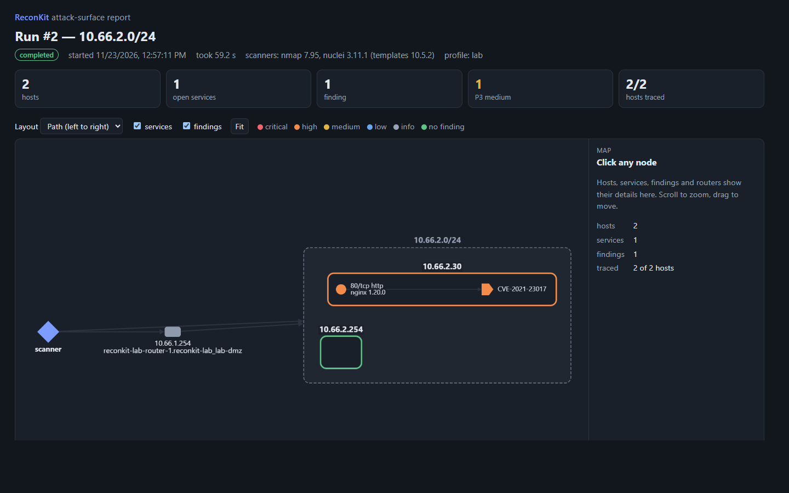

# ZuesScan

[](https://github.com/B23DCAT011/ZuesScan/actions/workflows/ci.yml)


**Continuous reconnaissance and vulnerability management, self-hosted.** ZuesScan scans only what
it is authorised to scan, remembers everything it has seen, and tells you what to fix first —
and whether the fix actually worked.

It orchestrates open-source scanners (nmap, naabu, httpx, subfinder, dnsx, nuclei, SSH package
checks), maps versions to CVEs from NVD, prioritises them by CISA KEV → EPSS → CVSS, and tracks
every finding across scans with a tamper-evident audit trail.

> ⚠️ Use only on systems you own or have written permission to test.

| Findings dashboard | Attack-surface map (scanner → router → subnet → host → service → CVE) |
|---|---|
|  |  |

## Try it in two commands

Requires Docker. Brings up the service next to a deliberately vulnerable lab network
(Apache 2.4.49, OpenSSH 7.5, a Log4Shell app, nginx behind a router):

```bash
git clone https://github.com/B23DCAT011/ZuesScan && cd ZuesScan
sh lab/up.sh      # service + lab; prints an operator token once → http://127.0.0.1:8000
sh lab/demo.sh    # claim fixes, really fix one, rescan → one "fixed", one "fake fix"
sh lab/down.sh    # remove the lab and its database
```

On the lab, nuclei **confirms** CVE-2021-41773 (Apache path traversal, KEV → P1), Terrapin on
OpenSSH, and Log4Shell through an out-of-band DNS callback to the lab's own interactsh server.
CI runs this whole chain on every push.

To run it for real: `docker compose up -d --build`, then
`docker compose exec web zues user add me --role admin`, and configure scopes and targets in
**Settings**. The CLI also works on its own (with nmap installed): `pip install .` then
`zues scan 10.0.0.0/24 --scope scope.txt`.

## What makes it different from "run nmap on a cron"

- **Scope gate before every packet.** Allowlist / denylist, permissions that expire
  (`@expires`), time windows (`@window`) and an activity ceiling (`@activity`: passive → scan →
  active). A domain name is scanned only if it resolves to an address inside the scope.
  Scope changes can require a second admin's approval.
- **Finding lifecycle.** Each finding has a stable fingerprint, so it is tracked across scans:
  new → open → claimed fixed → **verified fixed**, or **fake fix** when someone claimed a fix
  and the next scan still sees it. Risk acceptance needs a reason, an owner and a review date.
- **Evidence over inference.** Version-based CVEs are labelled as inferred; nuclei re-runs the
  matching template to confirm or refute them, and the dashboard filters by *confirmed /
  tried, not matched / inferred, not tried*.
- **Accountability.** Raw scanner output is stored with its SHA-256. The audit trail is a
  hash chain: who scanned what, under which scope, and who decided what (`zues audit --verify`).
- **Safe to extend.** Third-party plugins are pinned by SHA-256 before import and run in a
  separate process with a clean environment and a Landlock filesystem sandbox.
- **Built for AI agents, with a human in the loop.** `zues mcp` exposes the service over the
  Model Context Protocol. Every scan or decision an agent requests needs the user's
  confirmation through MCP elicitation, which the model cannot fill in itself. Scan data is
  treated as untrusted input (prompt injection).

## Architecture

```
 CLI (zues) ──┐                                ┌── nmap / naabu / httpx / dnsx /
 Dashboard ───┼─► FastAPI ──► Redis + RQ ──► worker ─┤   subfinder / nuclei / SSH
 MCP agent ───┘   (roles,     (JSON jobs,     (scope │
                   audit)     allowlisted)    gate)  └── plugins (subprocess + Landlock)
                     │                          │
                     └──────────► SQLite ◄──────┘   assets · runs · findings · evidence · audit chain
 scheduler ──► enqueue on cron        alerts ──► webhooks (signed, per-route, retried)
```

- Python 3.11+, zero runtime dependencies in the core; FastAPI and RQ only in the `server` extra.
- Plain JavaScript dashboard with no build step and a strict CSP (`script-src 'self'`).
- Outputs: offline HTML attack-surface map (Cytoscape.js), JSON, SARIF 2.1.0.
- Hardened Docker Compose (non-root, read-only root filesystem, all capabilities dropped
  except what nmap needs, generated Redis password).
  Release images are multi-arch, signed with cosign (keyless) and scanned with Trivy.

## Engineering

- **1,096 tests**, run in clean core and server containers before every push; CI also scans the
  vulnerable lab end to end.
- Every design decision is written down with its reasons (19 so far, in Vietnamese):
  [`docs/THIET-KE.md`](docs/THIET-KE.md).
- Known limitations are documented rather than hidden: [`docs/KNOWN-GAPS.md`](docs/KNOWN-GAPS.md).
  Examples: authenticated scans cover Debian only; no SSO or 2FA yet; SQLite limits scale;
  alerts are webhooks only.

A security bug found and fixed in its own design: RQ deserialises jobs with pickle, so a
plugin that could reach Redis could run code in the worker outside its sandbox. The fix uses
two layers: JSON-only jobs on an allowlisted worker, and a Redis password that sandboxed
plugins cannot read (decision D19).

## Documentation

Full documentation (Vietnamese): [`README.vi.md`](README.vi.md). It covers installation,
every plugin, scheduling, the web API and roles, Docker, the lab, MCP and releases.
Plugin authors: [`docs/PLUGINS.md`](docs/PLUGINS.md). Changes: [`CHANGELOG.md`](CHANGELOG.md).

## License

MIT — see [`LICENSE`](LICENSE).
